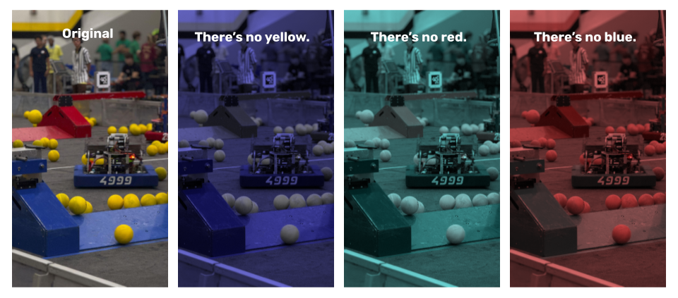

# Colorless Color

## What is this?

This is a program I wrote in C++ that does a few things. First, background, then what the heck this program is.

## Background

Ever heard of the Land effect? It's a relatively obscure optical illusion. First performed by Something Land in 19??, here are the steps:

1. Take the image, and run it through a red filter. Call this ```image_red```
2. Take the image, and run it through a green filter. Call this ```image_green```
3. Run ```image_green``` through a grayscale filter. Call this ```image_bw```
4. Project ```image_red``` and ```image_green``` on top of each other.

Instead of looking like a red filtered version of the image, you can kind of see color! There's a good demonstration [here](https://land.t-a-y-l-o-r.com/).



Also, I learned of some experiments by Akiyoshi Kitaoka related to this effect. You can read about it [here](https://michaelbach.de/ot/col-strawbsNotRed/index.html). [Here](https://www.psy.ritsumei.ac.jp/akitaoka/ECVP2015.html) is some more of his research. He related equations describing color filtering to the Land effect. So now...

## What is this?

This is a program I wrote in C++ that does a few things. Here are the things:

- Accept an image from the user
- Simulate the image being viewed through red, green, blue, yellow, cyan, and magenta filters
- Simulate the Land effect with not just a red/green filter but every possible combination of the six previously mentioned colors
- Write the images to a folder
- Optionally open the images

It only does Windows so far. (I think?)

## How do I use it?

### Windows

Download the C++ file (or EXE). Compile the C++ file (look it up). Run the EXE.

### Linux/Mac/the others

Download the C++ file. Compile the C++ file (look it up). Run the ```.x64```?

### Haha, after I compiled it.

Ohhh...

Run it in the command line. Something like this: ```colorless_color [filename] [-o]```. The filename is the filename. Without it, a dialog box will open. The ```-o``` flag will cause the images to open as they are generated (there's 64 of them!).

By default, the images will be saved in a folder whose name matches the original image.

**Note: orange is not working properly at the moment. Any help would be appreciated.**
